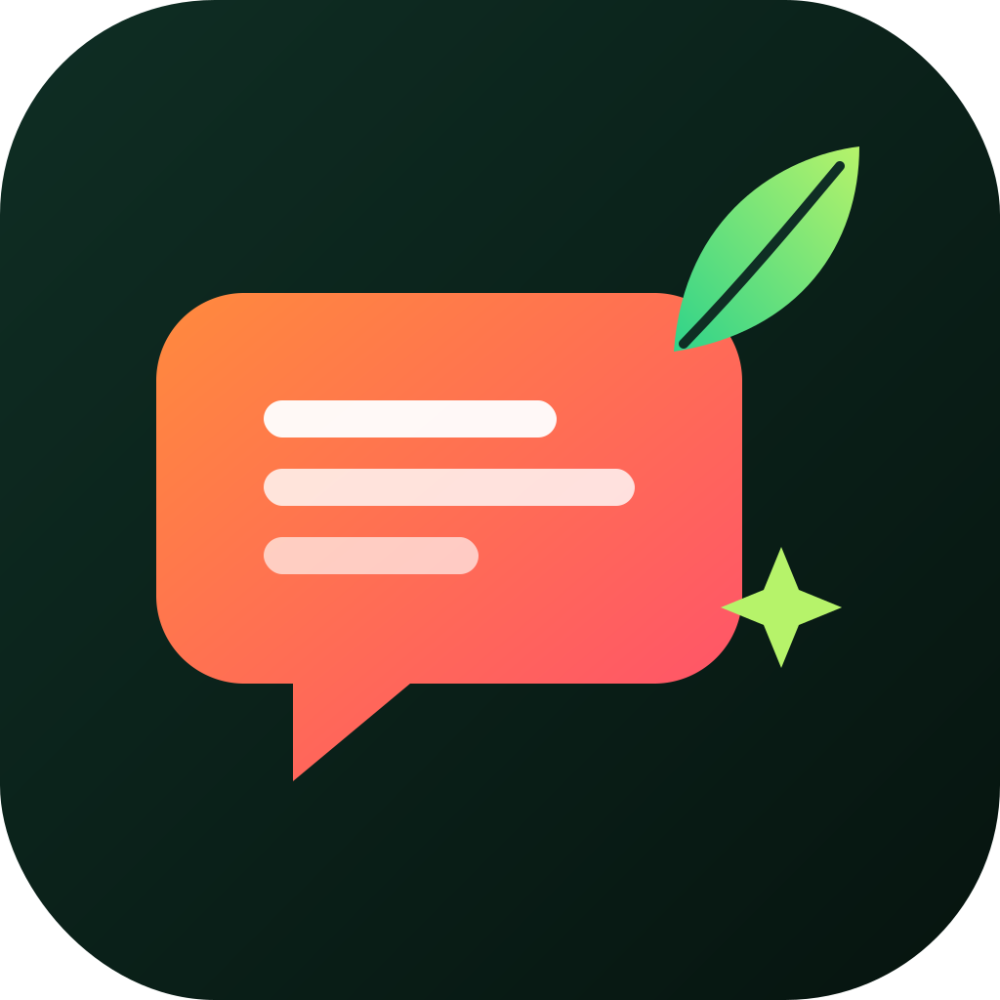
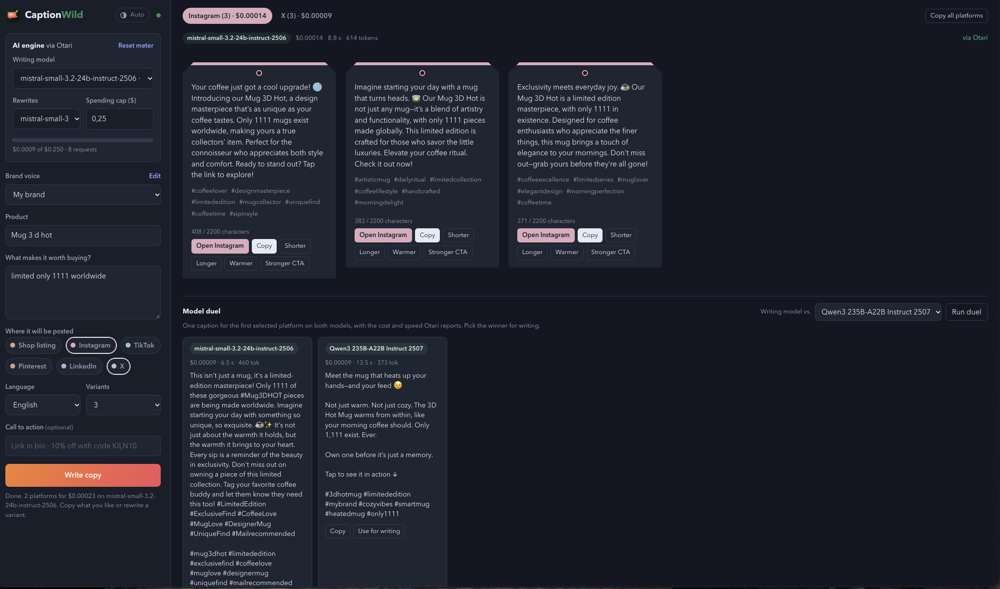

# CaptionWild

**Any model. Every caption. Cost under control.**

CaptionWild writes product descriptions, social media captions and hashtags in your brand's voice, on any model, and shows what every caption cost. All AI traffic goes through [Otari](https://github.com/mozilla-ai/otari), the open-source LLM gateway by Mozilla.ai.

Built for **Developers Wilding** (Mozilla.ai hackathon at MozFest 2026).

**Live demo:** https://captionwild.netlify.app · **Demo video:** https://youtu.be/bggXsf9O634



## Why

Small sellers write the same kind of copy every day: a shop listing, an Instagram caption, a TikTok caption, a pin. An AI writer helps, but two questions come up quickly: *which model is good enough?* and *what is this costing me?* Most apps hide both. CaptionWild makes them part of the product, and Otari does the hard work behind it.

## What it does

- **One brief, six platforms.** Shop listing, Instagram, TikTok, Pinterest, LinkedIn and X, each with its own length, structure and hashtag count. Several angles per platform.
- **Brand voices.** Save how your brand sounds, who buys, words to avoid and emoji style.
- **Pick any model.** The model list comes live from Otari, with a price estimate per platform next to each model. Cheapest first.
- **Separate rewrite model.** Write with a strong model, run the many small rewrites (shorter, longer, warmer, stronger CTA) on a cheap one.
- **Cost of every caption.** Each platform tab shows the exact cost Otari reported (`usage.cost_usd`), plus model, time and tokens. The run total is shown when it finishes.
- **Spend meter and cap.** A session meter adds up every request. Set a cap in dollars and the app stops before going over it.
- **Hard budget from Otari.** The real limit sits on the Otari key: when its budget runs out, Otari refuses the request and the app says so clearly. The browser can't get around it.
- **Model duel.** The same brief on two models side by side, with cost and speed, and a verdict on which was cheaper and faster. One click makes the winner the writing model.
- **Spend tags.** Every request carries tags (`app`, `platform`, `action`, `run`, `language`), so the Otari dashboard can break spend down by platform or by rewrites vs. first drafts.
- **No invented facts, 12 languages, share buttons, history.**

## How Otari is used

```
Browser ──► /api/models ─┐                      ┌─► OpenAI
        └─► /api/llm ────┴─► Netlify Function ──► Otari gateway ──► Anthropic
                              (holds the key)    (budgets, pricing,  ─► Mistral, open-weight, …
                                                  routing, usage)
```

| Otari feature | Where CaptionWild uses it |
|---|---|
| One OpenAI-compatible endpoint for many providers | `POST /api/v1/chat/completions` with `provider:model` ids |
| Model catalog with prices | `GET /api/v1/models` fills the model pickers and price hints |
| Inline cost per request | `usage.cost_usd` → cost per platform, run total, spend meter, duel verdict |
| Budgets enforced before dispatch | Budget on the API key; budget errors are shown as "Otari budget used up" |
| Request tags (`metadata`) | Spend per platform / action on the Otari dashboard |
| `Otari-Request-ID` | Returned to the client for tracing a request |

The Otari key never reaches the browser. The function also clamps `max_tokens`, limits prompt size and can restrict models with an allow-list.

## Models

The live demo runs on open-weight models served by Otari: Mistral Small 3.2 writes, Qwen3 235B and Llama 3.3 70B are the duel opponents. A caption costs around $0.00005, so a thousand cost about five cents. `/api/health?probe=1` sends a 5-token request to the likeliest models and shows which ones answer on your Otari account.

## Setup

### 1. Otari

1. Sign in at [otari.ai](https://otari.ai) and add a provider key (or use the models Otari hosts).
2. Create an **API key** (`otk_…` on otari.ai, `tk-…` on a self-hosted Otari). EU keys work too: the app follows Otari's region redirect automatically.
3. Recommended: give the key a **budget** (e.g. $2 per day) so the public demo can never run away.

Self-hosting works too: run Otari with Docker Compose and set `OTARI_BASE_URL=http://your-host:8000/api/v1`.

### 2. Deploy on Netlify

1. Import this repo in Netlify (no build command, publish directory `public`).
2. Under **Site configuration → Environment variables** add:

| Variable | Required | Example |
|---|---|---|
| `OTARI_API_KEY` | yes | `otk_v1_…` |
| `OTARI_BASE_URL` | no | `https://api.otari.ai/api/v1` (default) |
| `OTARI_MODELS` | no | `mistral:mistral-small-latest,openai:gpt-4o-mini` (allow-list) |

3. Deploy. The green dot next to the theme button means Otari is connected.

### 3. Run locally

Node 18+ is enough, no dependencies:

```bash
OTARI_API_KEY=tk-... node scripts/dev-server.mjs      # http://localhost:8888
```

Without an Otari account, use the bundled mock (prices requests and enforces a $0.05 budget like Otari does):

```bash
node scripts/mock-otari.mjs &
OTARI_BASE_URL=http://localhost:8787/api/v1 OTARI_API_KEY=tk-mock node scripts/dev-server.mjs
```

With no key at all, the app opens in demo mode with sample copy.

## Project layout

| Path | What |
|---|---|
| `public/index.html`, `style.css`, `app.js` | The app (no framework, no build) |
| `netlify/functions/llm.mjs` | `POST /api/llm`: one chat completion through Otari, returns text, cost, tokens, time |
| `netlify/functions/models.mjs` | `GET /api/models`: text models with prices, cheapest first |
| `netlify/lib/otari.mjs` | Otari client and error mapping (budget, rate limit, auth, pricing) |
| `scripts/dev-server.mjs` | Local server that runs the functions |
| `scripts/mock-otari.mjs` | Offline stand-in for the Otari API |

CaptionWild grew out of Caption Studio (my earlier Anna app). For this hackathon the AI layer was replaced with Otari, and model choice, per-request cost, spend cap, budget handling, spend tags and the model duel were added.

## Feedback to Otari

Issues opened on the Otari repository while building CaptionWild:

- [#2728](https://github.com/mozilla-ai/otari/issues/2728): document regional API hosts for hosted keys (EU keys get 421 on api.otari.ai)
- [#2729](https://github.com/mozilla-ai/otari/issues/2729): `GET /models` lists models that every provider refuses

## License

MIT
